# 🛡️ Školenie kybernetickej bezpečnosti (ITSEC)

Vitajte v komplexných študijných materiáloch a poznámkach zo školenia kybernetickej bezpečnosti. Tento repozitár a Obsidian vault obsahuje kompletné informácie, metodické pokyny, praktické ukážky a vizuálne schémy extrahované z prezentácií školenia.

Všetky materiály sú formátované v **Obsidian Markdown syntaxi** s podporou obojsmerných prepojení (`[[...]]`), značiek (tagov), Obsidian calloutov a prepojení na obrázky a schémy uložené v priečinku `static/`.

---

## 🧭 Štruktúra školenia

Školenie je rozdelené do dvoch hlavných modulov podľa cieľovej skupiny:
1. **Modul A:** Určený pre korporátnych a bežných používateľov (zamestnancov firiem, administratívu, manažment).
2. **Modul B:** Určený pre IT administrátorov, správcov sietí a bezpečnostných technikov.

```mermaid
flowchart TD
    subgraph ModulA["Modul A: Korporátni používatelia"]
        A1["[[A_blok_1_hrozby_a_phishing|Blok 1: Hrozby, sociálne inžinierstvo & e-mail]]"]
        A2["[[A_blok_2_hesla_mfa_a_sit|Blok 2: Ochrana PC, heslá (hash), MFA & sieť]]"]
        A3["[[A_blok_3_sharepoint_a_spoluprac|Blok 3: OneDrive, SharePoint & spolupráca]]"]
        A4["[[A_blok_4_gdpr_a_ai_bezpecnost|Blok 4: Ochrana údajov, GDPR & AI nástroje]]"]
        A1 --> A2 --> A3 --> A4
    end

    subgraph ModulB["Modul B: Správcovia sietí (Administrátori)"]
        B1["[[B_blok_1_sietova_infrastruktura_a_skenovanie|Blok 1: Sieťová infraštruktúra & skenovanie]]"]
        B2["[[B_blok_2_perimetricka_ochrana_wifi_a_firewally|Blok 2: Perimetrická ochrana, Wi-Fi & NGFW]]"]
        B3["[[B_blok_3_sledovanie_prevadzky_logy_a_wazuh|Blok 3: NIDS Suricata, zber logov & SIEM Wazuh]]"]
        B4["[[B_blok_4_ochrana_edr_threat_hunting_a_legislativa|Blok 4: EDR, Threat Hunting, Honeypot & Legislatíva]]"]
        B1 --> B2 --> B3 --> B4
    end
```

---

## 📋 Prehľad blokov a študijných materiálov

### 👤 Modul A: Bezpečnosť pre bežných používateľov

Zamerané na prevenciu útokov sociálneho inžinierstva, bezpečnú prácu s e-mailom, ochranu identity a zodpovedné používanie firemných dát a nástrojov umelej inteligencie.

| Blok | Názov a zameranie | Časový rozsah | Zdrojový PPTX | Markdown poznámka |
| :--- | :---------------- | :------------ | :------------ | :----------------- |
| **Blok 1** | Kybernetické hrozby, sociálne inžinierstvo, phishing & bezpečný e-mail | 08:00 – 09:30 | `A_blok_1_hrozby_a_phishing.pptx` | [[A_blok_1_hrozby_a_phishing\|A_blok_1_hrozby_a_phishing.md]] |
| **Blok 2** | Ochrana PC, tvorba hesiel, hashovacie funkcie, MFA, správcovia hesiel & verejná sieť | 09:45 – 11:15 | `A_blok_2_hesla_mfa_a_sit.pptx` | [[A_blok_2_hesla_mfa_a_sit\|A_blok_2_hesla_mfa_a_sit.md]] |
| **Blok 3** | Cloudové úložiská, OneDrive, SharePoint, prístupové práva, verzionovanie & tímová spolupráca | 12:15 – 13:45 | `A_blok_3_sharepoint_a_spoluprac.pptx` | [[A_blok_3_sharepoint_a_spoluprac\|A_blok_3_sharepoint_a_spoluprac.md]] |
| **Blok 4** | Ochrana osobných a firemných údajov, GDPR, klasifikácia informácií & bezpečnosť pri práci s AI | 14:00 – 15:30 | `A_blok_4_gdpr_a_ai_bezpecnost.pptx` | [[A_blok_4_gdpr_a_ai_bezpecnost\|A_blok_4_gdpr_a_ai_bezpecnost.md]] |

---

### 💻 Modul B: Pokročilá bezpečnosť pre administrátorov

Zamerané na technickú implementáciu obrannej architektúry (Defense in Depth), segmentáciu sietí, monitorovanie prevádzky, analýzu logov a legislatívne požiadavky.

| Blok | Názov a zameranie | Časový rozsah | Zdrojový PPTX | Markdown poznámka |
| :--- | :---------------- | :------------ | :------------ | :----------------- |
| **Blok 1** | Hierarchický trojvrstvový model, DMZ, VLAN (802.1Q), Port Security, DHCP Snooping & Nmap / OpenVAS | 08:00 – 09:30 | `B_Blok 1_ Sieťová infraštruktúra a skenovanie.pptx` | [[B_blok_1_sietova_infrastruktura_a_skenovanie\|B_blok_1_sietova_infrastruktura_a_skenovanie.md]] |
| **Blok 2** | Podniková Wi-Fi, WPA2 vs WPA3, 802.1X FreeRADIUS, Evil Twin, NGFW firewally, DPI & WireGuard VPN | 09:45 – 11:15 | `B_Blok 2_ Perimetrická ochrana, Wi-Fi & Firewally.pptx` | [[B_blok_2_perimetricka_ochrana_wifi_a_firewally\|B_blok_2_perimetricka_ochrana_wifi_a_firewally.md]] |
| **Blok 3** | Systémy IDS/IPS Suricata (eve.json, jq), Syslog-ng, Graylog, SIEM/XDR platforma Wazuh & FIM | 12:15 – 13:45 | `B_Blok 3_ Sledovanie prevádzky, Logy & Wazuh.pptx` | [[B_blok_3_sledovanie_prevadzky_logy_a_wazuh\|B_blok_3_sledovanie_prevadzky_logy_a_wazuh.md]] |
| **Blok 4** | Antivírus vs EDR, vyšetrovanie cez Velociraptor, Sigma detekčné pravidlá, Honeypoty, Zákon 69/2018 Z.z. & CERT tímy | 14:00 – 16:00 | `B_Blok 4_ Ochrana EDR, Threat Hunting & Legislatíva.pptx` | [[B_blok_4_ochrana_edr_threat_hunting_a_legislativa\|B_blok_4_ochrana_edr_threat_hunting_a_legislativa.md]] |

---

## 🖼️ Úložisko obrázkov a schém (`static/`)

Všetky grafické materiály, schémy architektúry sietí, ilustrácie hrozieb, ukážky nástrojov a ikony sú extrahované v originálnej kvalite a uložené v adresári `static/`.

- **Spôsob vloženia v Obsidian:** `![[static/nazov_obrazku.png]]`
- **Počet extrahovaných obrázkov:** 74 unikátnych grafických prvkov
- Obrázky obsahujú schémy trojvrstvových sietí, DMZ, VLAN značkovanie, Suricata schémy, Graylog architektúru, Wazuh SIEM dashboardy, ukážky phishingu, nástroje Keepass, Hashcat a ďalšie.

---

## 🛠️ Praktické cvičenia v moduloch

Každý modul obsahuje dedikované praktické cvičenia pripravené na interaktívnu výučbu:
- **Slide 1.9.1 (A1):** [[A_blok_1_hrozby_a_phishing#Slide 1.9.1. [CVIČENIE]: Nájdi podvodné znaky v e-maile|Identifikácia podvodných znakov v e-maili]]
- **Slide 1.10 (A1):** [[A_blok_1_hrozby_a_phishing#Slide 1.10 [CVIČENIE]: Praktický „Hover test“ na odkazoch|Praktický Hover test na webových odkazoch]]
- **Slide 2.9 (A2):** [[A_blok_2_hesla_mfa_a_sit#Slide 2.9 [CVIČENIE]: Názorná ukážka: Ako funguje HASH?|Názorná ukážka kryptografického hashu]]
- **Slide 2.10 (A2):** [[A_blok_2_hesla_mfa_a_sit#Slide 2.10 [CVIČENIE]: Overenie úniku na Have I Been Pwned|Overenie kompromitácie účtu na haveibeenpwned.com]]
- **Slide 4.9 (A4):** [[A_blok_4_gdpr_a_ai_bezpecnost#Slide 4.9 [CVIČENIE]: Názorná ukážka Canarytokens|Nasadenie a aktivácia Canarytokenu]]
- **Slide 4.10 (A4):** [[A_blok_4_gdpr_a_ai_bezpecnost#Slide 4.10 [CVIČENIE]: Ako bezpečne anonymizovať dáta pred zadaním do AI|Anonymizácia textu pred odoslaním do LLM]]
- **Slide 4.11 (A4):** [[A_blok_4_gdpr_a_ai_bezpecnost#Slide 4.11 [CVIČENIE]: Odhalenie halucinácie a neexistujúcich zdrojov|Detekcia AI halucinácií]]
- **Kontrolné testy (B1–B4):** Každý blok pre administrátorov končí sadou 4 kontrolných otázok a reálnych scenárov.

---

## ⚖️ Licencia a vylúčenie zodpovednosti tretích strán

Tento repozitár a študijné materiály sa riadia týmito pravidlami:
* **Vlastné texty, osnovy a štruktúra školenia:** Sú licencované pod medzinárodnou licenciou [Creative Commons Attribution 4.0 International (CC-BY 4.0)](LICENSE.md) (Autor: FORTIS AURIS)[cite: 1, 2].
* **AI ilustrácie a grafika:** Ilustrácie a grafické prvky generované pomocou umelej inteligencie (Gemini) sú voľne šíriteľné v režime Public Domain.
* **Externé diagramy a citácie:** Externé diagramy, schémy a ukážky prevzaté z externých zdrojov (napr. GeeksforGeeks, TechTarget, CBT Nuggets atď.) sú výhradným majetkom ich pôvodných autorov. Sú použité výhradne v rámci zákonnej vzdelávacej citácie na účely výučby a nevzťahuje sa na ne licencia CC-BY.
